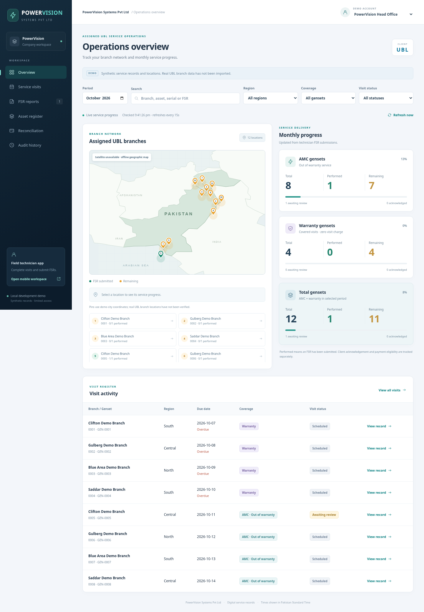
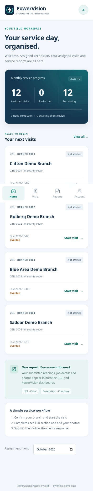

# PowerVision Systems Pvt Ltd — Genset AMC Management

A working development foundation based on the uploaded **Genset Digital AMC Management Requirements** (UBL, 10 pages). This first increment implements the service-report → branch-review → payment-eligibility workflow with synthetic records. It is not the complete contracted solution or a production banking deployment.

## Beginner quick start

Read [Start here — no programming experience needed](docs/beginner-guide.md). Windows users can double-click `START-AMC.bat`; macOS/Linux users can run `bash start-amc.sh`. You can also run `node scripts/start.mjs` on either platform. These helpers install, check and start the project without resetting saved records.

## Run

Requires **Node.js 24 or newer** (built-in SQLite), npm, and no external database or credentials.

```sh
cd /workspace/AMC-APP
npm ci --ignore-scripts
npm run check
npm test
npm start
```

The local server uses port 3000 and binds to loopback. `npm run dev` restarts when server files change. `PORT` and `AMC_DB_PATH` are optional runtime overrides. The default persistent database is `data/amc.sqlite`, ignored by Git. It contains synthetic data and submitted evidence; do not commit it. Stop with Ctrl+C. Sessions reset on restart; records persist.

This cloud task is already isolated. Use the existing checkout; do not create Git worktrees unless explicitly requested.

## Try the workflow

1. Select **Assigned Technician** using the demo workspace selector. Open AMC visits and choose **Complete FSR** for branch 0005 (OOW) or branch 0001 (warranty).
2. Complete all applicable fields and attach before/after/stamped-FSR images. Select values from the checklists; enter “None” when an issue, part, repair or action does not apply. Every applicable value is validated again by the API.
3. Select the corresponding **UBL Branch 0005 Reviewer (AMC)** or **UBL Branch 0001 Reviewer**. Open the submitted record and acknowledge it, or unacknowledge it with a reason.
4. Select **PowerVision Head Office** or **PowerVision Management**. View reconciliation and export the monthly CSV. Acknowledged OOW visits are PKR 3,500; warranty, pending and rejected visits are PKR 0.
5. View audit history. A rejected FSR may be resubmitted by its assigned technician; earlier submissions remain stored as immutable revisions and available through the history API.

The 12 synthetic assets include four warranty and eight OOW assets. These are demonstration data, not the document's 2,200 real gensets. Initial schedules belong to the month when the database was created; select that month after the calendar rolls over. Automated recurrence and master-data import are future work.

## Included

- PowerVision-branded responsive company, UBL head-office, technician and branch workspaces with filters, asset register and detailed FSR reports.
- Assigned UBL branch satellite map beside AMC, warranty and total cards; each shows total/performed/remaining from technician submissions, with automatic checks every 15 seconds. Esri satellite imagery requires internet; optional Google Maps hybrid mode uses a browser key. A labelled local geographic fallback remains available.
- Structured FSR schema corresponding to the section 12 table, including phase readings and conditional issue fields; required before/after/stamped-FSR images.
- Assignment, branch and client access checks enforced server-side; UBL head office sees UBL records and PowerVision management sees its vendor records.
- Server-computed identifiers, dates, delay status, PM flag and authoritative warranty/rates.
- Atomic workflow transitions, persistent SQLite storage, FSR revision history and actor/timestamp audit entries.
- Monthly visit-level payment report and CSV with FSR/acknowledgement traceability.
- Functional tests covering validation, access isolation, rejection/resubmission, eligibility, duplicate review, audit, persistence and HTTP sessions.

## Demo security boundary

The workspace selector deliberately permits selecting any demo identity without a password. It is **not production authentication**. The executable refuses non-loopback binding. Do not enter real customer or banking data, deploy publicly, or expose it through a tunnel. Session cookies are HttpOnly and SameSite; basic origin checks, CSP and role checks support local development but do not replace production identity/security review.

[Requirements analysis and delivery roadmap](docs/requirements-analysis.md) explains ambiguities and remaining requirements. [Architecture and API](docs/architecture.md) describes the implemented structure and future production architecture.

[Branch map, overview counting rules and optional Google Maps setup](docs/branch-map-and-overview.md).

[Detailed reports shared between UBL and PowerVision](docs/shared-fsr-reports.md) explains all fields, photos, revision history and printing.

## Overview preview



## Technician app

Use **Technician app ↗** on the dashboard to open the dedicated `/technician/` application. It includes assigned visits, visit start, a guided FSR, server-saved resumable drafts, camera/gallery uploads, submitted reports and client responses. [Technician app guide and limitations](docs/technician-app.md).

This is a mobile-ready web app with installable shell metadata, not a native Android APK. A shared phone deployment still requires hosted HTTPS and production authentication; the local demo is loopback-only.


