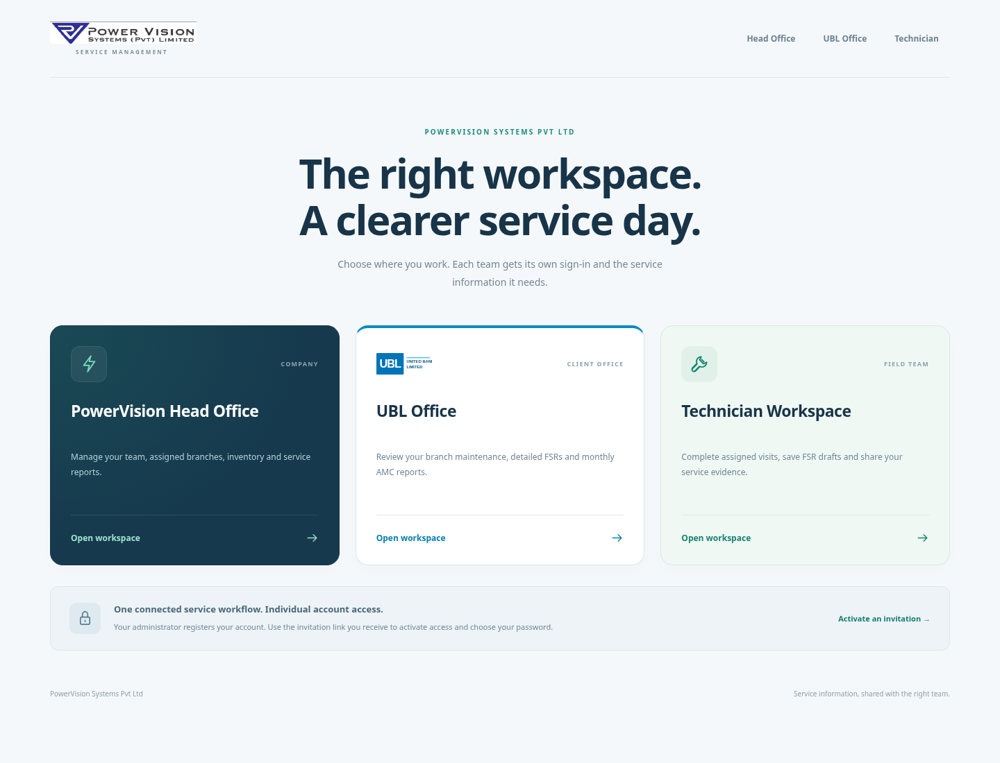

# PowerVision Systems Pvt Ltd — UBL Genset AMC

Separate account-protected workspaces for **PowerVision Head Office**, **UBL Office** and **Technicians**, with one shared service-report workflow. PowerVision registers technicians and office staff; the UBL administrator registers the bank's team. Inventory belongs to the PowerVision portal.

## Start here

Requires **Node.js 24 or newer** and npm. Windows: extract the project and double-click `START-AMC.bat`. macOS/Linux: run `bash start-amc.sh`. Both use:

```sh
node scripts/start.mjs
```

The starter installs the locked dependencies, checks the source, runs the tests and starts a local server on a free port. Use the port printed in the terminal on that same computer. Keep the terminal open. The cloud onboarding screen does not provide a localhost browser preview.

[Beginner instructions](docs/beginner-guide.md) · [Registration and portal access](docs/portal-access.md)

## Use one online link

For viewing updates without downloading a ZIP each time, use the prepared [Render hosting setup](docs/online-hosting.md). It connects GitHub `main` to automatic deployments and keeps accounts, reports, photos and inventory on a persistent disk. This uses a paid web service and disk; review the current cost in Render before creating them.

[Open Render deployment setup](https://render.com/deploy?repo=https://github.com/millitatechsolutions/AMC-APP)

After the owner connects GitHub and deploys, everyone uses the same HTTPS link with their own portal account. The first owner setup also needs a private generated setup key from the hosting dashboard. The repository is prepared for hosting; no Render account, payment or public service has been created by this change.



## First registration

1. Open the application and select **Set up PowerVision**. Create your own owner account with your name, email, employee ID and a password of 12–128 characters. No default password or account is supplied.
2. In **PowerVision Head Office → People & Technicians**, register a technician or a PowerVision colleague. Copy the generated invitation link and provide it to that person. The link expires after 48 hours and is used once to set their password. Email/SMS delivery is not configured or sent automatically.
3. Invite the first **UBL administrator** from PowerVision. Once activated, that administrator manages UBL office staff and branch reviewers through **UBL Office → UBL Team**. PowerVision cannot reset or disable active UBL accounts.
4. Assign an unstarted service visit to an active technician from the PowerVision visit register. The technician then signs in to the separate technician portal and sees only assigned work.

The owner setup becomes unavailable after the first account is created. Additional users cannot choose their own role, bank or portal through public registration. Accounts can be disabled, enabled and reset by their responsible administrator; disabling/resetting revokes sessions. Users can change their own password from the account menu.

## Workspaces

| Workspace | Access |
| --- | --- |
| PowerVision Head Office | PowerVision service operations, company FSRs, stock/inventory and payment reconciliation; administrators also manage staff/technicians and assignments |
| UBL Office | UBL assets, service progress, detailed FSRs, paper-image verification and the AMC Excel report; UBL administrators manage UBL accounts |
| UBL branch reviewer | Only the assigned UBL branch's records and acknowledgment actions |
| Technician | Only assigned visits, saved drafts, service readings, material usage, evidence and client/company responses |

Portal and record permissions are checked by the API. A different URL or request does not grant another portal's access. UBL cannot read company stock balances, receipts, movements or payment reconciliation. It still receives the material quantities used in its own FSR, as part of the shared service evidence.

## Service workflow

The technician records the service form and completed signed/stamped paper FSR image. Both UBL and PowerVision receive the same immutable submitted revision. Each can manually compare the image against the entered values and record a separate verification result. The matching branch acknowledges the visit or requests corrections. Stock deducts on FSR submission; a correction changes only the quantity difference. Only acknowledged out-of-warranty visits qualify for the stored AMC payment rate.

- [Paper FSR V02 and UBL reporting](docs/fsr-v02-and-ubl-reports.md): all 225 fields, uploads, comparison and revision behavior.
- [AMC Excel sources](docs/amc-excel-column-mapping.md): all 69 uploaded-template columns, typed values, blanks and exact source mapping.
- [Inventory management](docs/inventory-management.md): catalogue, receipts, low-stock alerts and FSR-linked movements.
- [Technician app](docs/technician-app.md): guided form, server drafts and mobile use.
- [Map and overview](docs/branch-map-and-overview.md): satellite imagery, demo coordinates and progress counts.
- [Architecture and API](docs/architecture.md): authentication, data tables, scope checks and endpoints.

## Local development and data

```sh
npm ci --ignore-scripts
npm run check
npm test
npm start
```

The server binds to loopback by default. Explicit hosted mode validates the configured HTTPS origin and uses a separately configured persistent database path; see [hosting settings](docs/online-hosting.md). For local installs the default database is ignored `data/amc.sqlite`; optional `.env` supplies map configuration. **Preserve both when upgrading.** Extract a new download into a fresh folder and copy the old `data` folder and optional `.env` before its first start. Never replace two existing databases blindly.

Fresh data contains 12 clearly synthetic UBL assets, four warranty and eight out of warranty. Real branches, GPS locations and fleet master data have not been imported. Earlier mistaken HBL demo records are preserved on disk but excluded from registered portal views; no new HBL records are seeded. Old submitted evidence and stock history are retained. Select the stored visit month if the calendar changes.

Passwords use salted scrypt hashes, and invitation/session tokens are stored as hashes. Session cookies are HttpOnly and SameSite, with separate portal bindings; request-origin and local-host checks are enforced. Legacy selectable demo identities are available only through an explicit in-process automated-test fixture option; normal startup never enables them.

The working local account system is not a hosted bank deployment. Shared phone use still requires reviewed HTTPS hosting and operational identity, backup and recovery arrangements. No public website, enterprise SSO/MFA or native APK has been deployed. The latest user-provided PowerVision purple mark and UBL swoosh references are used as web reproductions across the portal branding. Their aspect ratios are preserved; PowerVision includes a separate company-name lockup.

This cloud task is already isolated. Use the existing checkout rather than creating a Git worktree unless explicitly requested.
