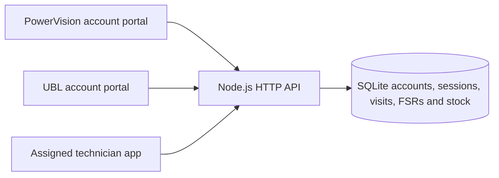

# Architecture and API

## Local structure

Node.js 24 supplies HTTP, SQLite, crypto and filesystem operations. ExcelJS writes the real 69-column XLSX. Browser modules implement the landing pages, private office dashboards and mobile technician app. Locally vendored Leaflet displays Esri satellite imagery when available; a labelled local fallback remains usable. Optional Google Maps uses a restricted browser key.

## Account and portal boundary

`src/auth.js` stores accounts, salted scrypt password hashes, hashed random session/invitation tokens, rate-limit buckets and immutable account audit history. First-owner setup is one-time and race checked inside a transaction. Other accounts require a 48-hour, single-use invitation, followed by explicit login. There are no default passwords or public self-selected roles. Reset/disable/password change revoke sessions; stale disabled principals are rejected through a fresh database lookup.

The executable always starts account authentication. `createApp({demoMode:true})` is an explicit in-process legacy regression fixture; no environment variable or HTTP input turns it on. `/api/session` and `/api/demo-users`, including their portal-namespaced variants, are absent in normal mode.

- Public pages: `/`, `/powervision`, `/ubl`, `/technician/login`, `/setup`, `/activate`.
- Private pages: `/powervision/app`, `/ubl/app`, `/technician/`.
- Private API namespaces: `/api/powervision/`, `/api/ubl/`, `/api/technician/`.
- Cookies: `amc_powervision_session`, `amc_ubl_session`, `amc_technician_session`; HttpOnly, SameSite=Strict, eight-hour maximum, Secure when the connection is HTTPS.
- A session is bound to its account's portal. An unauthenticated private page redirects to its login; a different portal's session receives 403. Private API requests require the matching portal cookie.

PowerVision administrators manage PowerVision staff and technicians. They may invite the first UBL administrator; after activation, UBL administrators manage their own office users and branch reviewers. PowerVision may renew its original pending first-UBL invitation while it has never been activated, but cannot manage active UBL accounts. Administrators cannot disable/reset themselves or remove the last active administrator's access.

Record checks additionally enforce active status, actual company ownership on both asset and visit, UBL client ownership, branch assignment and technician assignment. A registered PowerVision head-office account does not inherit the legacy test fixture's unrestricted head-office scope. UBL cannot read inventory/catalogue/payment endpoints. Technicians may read the parts catalogue for service consumption, but cannot read or manage the stock ledger.

Mutating requests reject foreign Origins. Local Host checks and executable loopback binding prevent arbitrary public hosting. CSP, frame denial, no-referrer and no-store private/API responses support this local boundary. The technician service worker caches only public static assets, never private HTML, API data, photos or credentials. A reviewed shared HTTPS deployment, enterprise identity/MFA and operational recovery remain separate work.

## Data dictionary

| Table | Purpose |
| --- | --- |
| assets | Branch, client/vendor, model/engine, warranty, stored rate and previous-service baseline |
| visits | Monthly assigned visit, due date, latest submitted FSR and branch decision |
| fsr_versions | Immutable submission snapshots, including bounded image evidence |
| fsr_verifications | Append-only company/client manual decisions tied to an exact FSR revision |
| technician_drafts | Assigned technician draft and optimistic-concurrency revision |
| audit | Service, inventory and assignment actor/action history |
| inventory_items | Catalogue and integer-thousandth stock balances |
| inventory_movements | Immutable opening, receipt and FSR consumption/correction ledger |
| auth_accounts | Portal, role, administration scope, status and password hash |
| auth_sessions | Hashed token, account, portal and expiry |
| auth_tokens | Hashed single-use activation/reset token and expiry/use time |
| auth_login_limits | Persistent short-window sign-in attempt limits |
| auth_audit | Immutable account/session action history |
| app_migrations | Additive upgrade markers |

Evidence is stored as bounded data URLs in this local SQLite foundation. Up to five 2 MB JPEG/PNG/WebP images fit within the 18 MB service request limit; account/auth payloads have a separate 64 KB bound. Production-scale storage, media processing and fleet-load validation remain separate requirements.

## Public authentication API

| Method | Path | Behavior |
| --- | --- | --- |
| GET | /api/health | Readiness, synthetic-data mode and account-authentication indicator |
| GET | /api/auth/status | Whether the initial owner exists; invite-only registration mode |
| POST | /api/auth/bootstrap | First owner name/email/employeeId/password; creates owner and PowerVision session once |
| POST | /api/auth/login | Portal/email/password; sets matching portal cookie |
| POST | /api/auth/invitation | Opaque invitation token; returns minimal invited-account details |
| POST | /api/auth/activate | Token/password; consumes invitation, does not log in automatically |
| POST | /api/auth/logout | Portal; revokes that cookie's session |
| POST | /api/auth/password | Portal/currentPassword/newPassword; requires matching account session, then revokes its sessions |

Invitation URLs use `/activate#TOKEN`; the fragment is read in the browser and sent in an API body, not in the server request URL. Tokens are not included in audits or stored in plaintext. Copy/share delivery is manual; no email provider is configured.

## Private API

Replace `:portal` with `powervision`, `ubl` or `technician`. The namespace itself does not grant permission.

| Method | Path under `/api/:portal/` | Behavior |
| --- | --- | --- |
| GET | me | Current authenticated profile |
| GET | fields | 225-field FSR dictionary |
| GET | visits?summary=1 | Authorized lightweight visits without evidence payloads |
| GET | visits/:id | Authorized full visit |
| GET | visits/:id/report | Same complete FSR, identities, evidence, revisions, verification and activity for authorized parties |
| GET | visits/:id/history | Immutable submitted snapshots |
| POST | visits/:id/start | Assigned technician first-start event |
| GET / POST | visits/:id/draft | Assigned editable draft with concurrency revision |
| POST | visits/:id/submit | Assigned technician validated FSR; atomically applies stock usage and clears draft |
| POST | visits/:id/review | Matching branch acknowledgment or correction request |
| POST | visits/:id/verify | Exact client/company reviewer manual decision on current revision |
| GET | assets / audit / map-config | Scoped master records, activity or browser map configuration |
| GET | inventory / inventory/catalogue | Company stock register, or technician service picker where authorized |
| POST | inventory/items / inventory/receipts | PowerVision stock creation/receipts |
| GET | payments / export.csv | Company-only monthly reconciliation |
| GET | amc-report / amc-report.xlsx | Authorized UBL monthly 69-column preview/XLSX with Data sources sheet |
| GET / POST | accounts | Scoped administrator account listing/invitation |
| POST | accounts/:id/action | Scoped enable/disable/reset/reinvite |
| GET | technicians | PowerVision admin's active registered technicians |
| POST | visits/:id/assign | PowerVision administrator assigns an active technician to an untouched UBL visit |

Assignment rejects started visits, drafts, existing FSR history and foreign ownership. No historical FSR author is changed when registering a new technician. Submitted reports are corrected only through the existing branch-rejection flow.

FSR submission, immutable revision, stock balance/ledger, draft cleanup and visit status share one transaction. Manual verification does not change stock or acknowledgment. A corrected submission resets current verification results while preserving earlier decisions. Only acknowledged OOW visits are payable at their stored rate.

Fresh data is twelve UBL synthetic assets. Earlier mistaken HBL demo records are retained but hidden from registered portal views; fresh startup does not recreate them. This preserves evidence and stock history without presenting the wrong bank as the active client.

[Portal registration](portal-access.md) · [Paper FSR and UBL reporting](fsr-v02-and-ubl-reports.md) · [Inventory](inventory-management.md)
