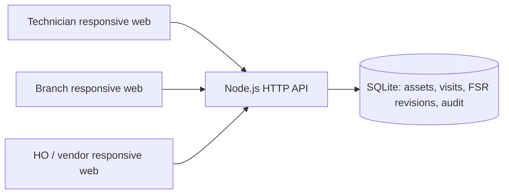
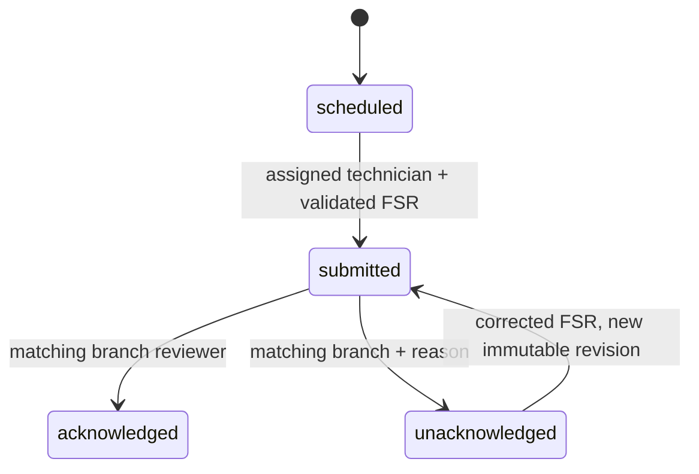

# Architecture and API

## Current development structure

No third-party runtime dependencies or remote services are required for the default local demo; Google Maps is optional. Node 24 supplies HTTP, file I/O, UUIDs and SQLite. The frontend uses browser modules, semantic forms and CSS. This keeps the initial workflow runnable while platform and identity requirements are clarified. HTML/client data never supplies the authoritative rate, branch assignment or warranty classification.

## Data dictionary

| Table | Key fields | Purpose |
|---|---|---|
| assets | id, JSON payload | Branch/region/vendor relation, engine/model, warranty, rate and legacy service baseline |
| visits | id, asset_id, month, status, JSON payload; unique(asset_id, month) | Assigned synthetic monthly visit, due date, latest FSR and branch decision |
| fsr_versions | id, visit_id, JSON payload | Immutable submission snapshots, including evidence and computed values |
| audit | id, actor, action, entity, at, detail | Append-only application action/decision history |

FSR keys, groups, labels and checklist options are maintained in `src/fields.js`. Evidence is stored as bounded JPEG/PNG/WebP data URLs in JSON for this small local demo. Production must migrate to access-controlled object storage, validate/re-encode media, and use normalized typed PostgreSQL entities and migrations. SQLite synchronous access and embedded photos have not been fleet-scale load-tested.

## Workflow

Transitions and audit/revision writes are atomic. There is no submitted-FSR delete API. Acknowledged records cannot be edited through the current API. Corrections after acknowledgement, invoice locking, controlled administrative operations and finance reversals require a separately audited production design.

## Local API

All endpoints except health/demo-users/session creation require an HttpOnly local session cookie. The demo session creation endpoint intentionally has no authentication and must be replaced before production.

| Method | Path | Behavior |
|---|---|---|
| GET | /api/health | Readiness and synthetic-demo indicator |
| GET | /api/demo-users | Available synthetic identities |
| POST | /api/session | `{ "userId": "tech-demo" }` sets a demo session |
| GET | /api/me | Current identity |
| GET | /api/fields | Structured FSR schema |
| GET | /api/visits | Scope-filtered visits with latest FSR; `?summary=1` omits image bodies for lightweight overview polling |
| GET | /api/visits/:id | Scope-checked full visit/FSR detail |
| GET | /api/map-config | Browser Maps key/map ID when configured; browser keys must have HTTP referrer/API restrictions |
| GET | /api/assets | Scope-filtered asset register |
| POST | /api/visits/:id/submit | FSR field object; technician only |
| POST | /api/visits/:id/review | `{ "decision": "acknowledged" }` or `unacknowledged` with `reason`; branch only |
| GET | /api/visits/:id/history | Scope-checked immutable FSR revision history |
| GET | /api/audit | Scope-checked action/decision history |
| GET | /api/payments?month=YYYY-MM | HO/vendor statement including blocked/zero-charge rows |
| GET | /api/export.csv?month=YYYY-MM | Full authorized monthly payment statement, formula-safe CSV |

Status codes: 400 malformed input, 401 missing/expired session, 403 role/scope denial, 404 unknown entity/endpoint, 409 invalid transition, 413 request too large, 422 missing or invalid FSR/reason. The service runs in UTC for record timestamps. Localization and Pakistan calendar business rules require an approved policy.

## Proposed production architecture

- Responsive HO web frontend and Android technician/branch clients, backed by one versioned authenticated API.
- Enterprise identity provider with MFA and individual technician/branch account lifecycle. Scope assignments established centrally.
- PostgreSQL for normalized transactional state; private object storage with short-lived authorized attachment access; encrypted backups and tested restore procedures.
- Worker/queue for schedule generation, configurable reminders, escalation and scheduled reporting.
- Encrypted mobile offline storage with idempotent submission keys, versioned records and conflict handling; branch/payment decisions remain authoritative server-side.
- Hosting location, TLS, secrets management, telemetry, immutable audit retention and DR chosen against UBL-approved security requirements.

Overview counting, demo location provenance, and Google Maps setup are documented in [Branch map and overview](branch-map-and-overview.md).
