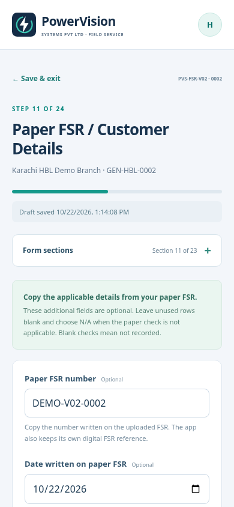
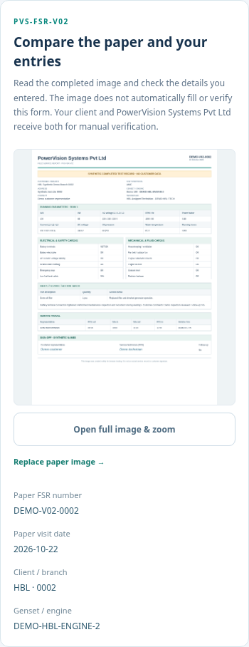
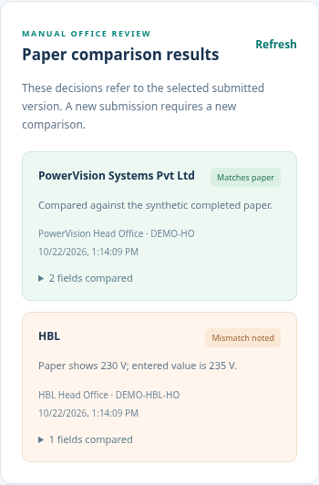
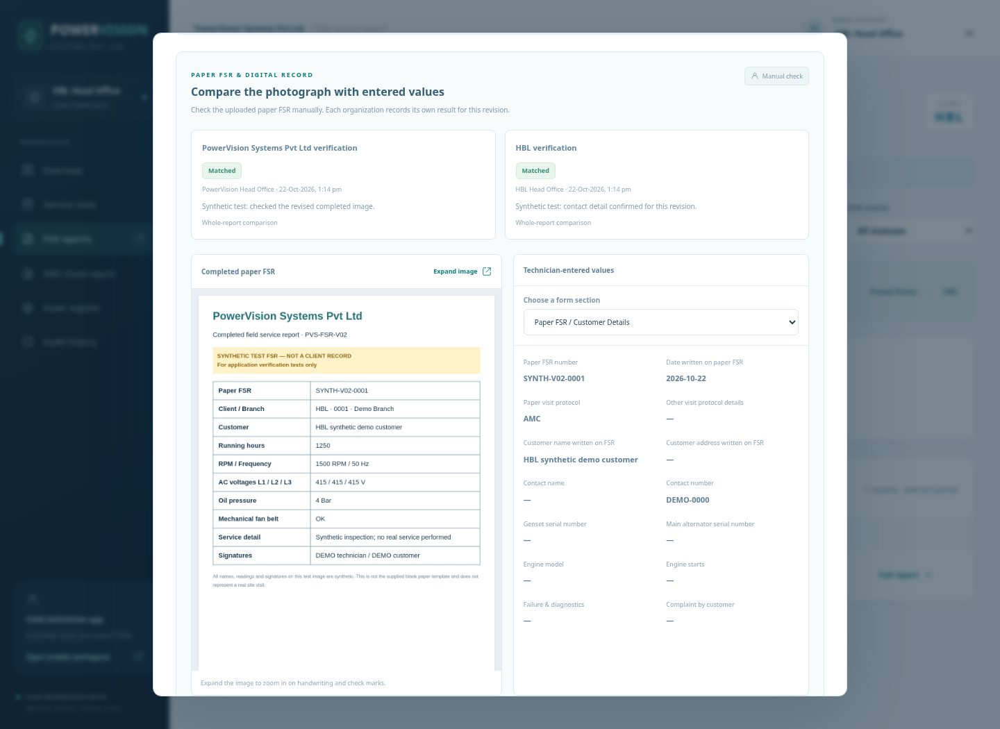
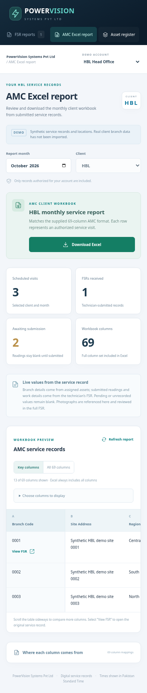

# Paper FSR V02, verification and HBL reporting

This update uses the supplied **FSR-V02.pdf** as a blank form reference and **Report Format AMC.xlsx** as an export format reference. The workbook's UBL example rows are not imported as HBL data. Neither attachment supplies application instructions or authority to contact anyone.

## Technician: record the paper FSR

1. Open **Technician app**, choose the HBL technician demo for HBL examples, and open an assigned visit. Start the visit or continue its draft.
2. Complete the existing core service fields. The section navigator also provides the paper-form sections: customer/paper reference, two representative travel rows, three running-parameter rows, electrical/safety/mechanical/fluid/leakage checks, filter quantities, ten spare-part rows, service detail, customer comments and sign-off.
3. Copy the **paper FSR number** and **date written on paper FSR** exactly. They are separate from the application's generated digital FSR reference and submission timestamp. The original core fields provide the first row's current running hours, kW, phase amperes, RPM/frequency, oil pressure and jacket-water temperature; additional paper fields provide the remaining readings and rows.
4. Upload a clear **Completed paper FSR image (signed / stamped)**, plus the existing before/after maintenance images. JPEG, PNG or WebP is supported, at most 2 MB per image. The optional customer and technician signature crops have the same limit. Draft and submission requests allow 18 MB to accommodate all five permitted images as JSON/base64. This upload accepts images; the blank reference PDF is not a completed service record.
5. At review, enlarge the paper image and compare the typed details before submitting. Use **Save draft** to continue later. Optional paper fields can be left blank if nothing was recorded; an empty check never becomes an assumed OK. Record **N/A** only when that is the recorded result.
6. Submit. The original typed details and paper image become one saved FSR revision, visible to the exact client and responsible service company. Old revisions remain available after correction.

The ten free-text paper spare-part rows transcribe the document. They do not automatically issue stock. Select the actual inventory items and quantities in **Issue / Job Management → Parts & materials used** to record stock consumption. Stock deducts on successful FSR submission; drafts and manual verification do not change stock. Corrections adjust only the quantity difference.

The expanded schema has 225 fields: the existing 75 core/evidence fields and 150 optional paper-form fields. Optional fields do not invalidate older reports or require invented readings. If an older client omits an optional paper field during a correction, its previously recorded value is retained; explicitly sending an empty value clears it.

## HBL and company: compare and verify

Open a submitted detailed FSR and its paper-image comparison area. Enlarge the image as needed and compare it against the structured fields. HBL and PowerVision each record their own **Matched** or **Mismatch** result. A mismatch requires an explanation; selected field names identify what was checked or found different.

This is a **manual evidence comparison**, not OCR or automatic proof that the technician's readings are accurate. A company's matched result does not mark the client's result matched. Both teams see who reviewed the revision, when, the decision and comments. Repeated reviews append history rather than overwriting an earlier decision.

Verification is distinct from branch acknowledgment and payment eligibility. A mismatch alone does not return stock, reject a visit or reopen an acknowledged report. To request a technician correction on a submitted visit, the matching branch reviewer uses the existing **Request correction** action. When the technician resubmits, the new revision's company/client checks start pending; prior checks remain attached to the earlier revision. A stale browser cannot verify an old revision as current.

Company verification belongs to the visit's actual vendor and matching asset owner. Client verification belongs to the matching client head office or branch. Technicians cannot verify their own submissions. HBL and UBL records remain isolated even when they use the same branch code. The map also keeps those branches separate.

## HBL: generate the Excel report

Choose **HBL Head Office → AMC Excel report**, select the reporting month, inspect the preview and choose **Download Excel**. PowerVision management can choose HBL or UBL. The spreadsheet follows the supplied 69-column A:BQ layout and includes a **Data sources** worksheet explaining every column. The preview can show selected columns without changing the complete exported workbook.

The source data comes from three places:

| Data | Source |
| --- | --- |
| Branch code, address, region, vendor, genset identity, warranty, last PM baseline | Recorded branch/asset master data and its saved submission snapshot |
| Schedule, month, generated reference, submission time, PM flag, timing status and next visit date | Stored visit and server-generated FSR values |
| Actual readings, inspections, faults, action taken, parts, customer sign-off and FSR evidence | Technician's submitted form and uploaded images |

Submitted snapshots take precedence over current master data. **Visit Date** uses the entered paper date where available, otherwise the older digital submission-date field. Numeric zero remains zero. An unfinished visit has blank technician readings. The FSR column contains a report reference and confirms that its image is available in the portal; images are not embedded in Excel. The additional paper checklist, travel, signatures and inventory detail remain in the full portal report because the supplied spreadsheet has no columns for them.

See [the complete 69-column mapping](amc-excel-column-mapping.md) for exact source keys and terminology differences. Missing master records cannot be filled with sample workbook values; real branch and asset import remains separate work.

## Demo and upgrade

The demo selector includes **HBL Head Office**, **HBL Branch 0001 Reviewer** and **HBL Assigned Technician**, alongside the existing UBL and company identities. Three clearly synthetic HBL assets/visits are added once to a recognizable demo database; real or mixed databases do not receive invented HBL records. Existing visits, drafts, evidence, stock and revisions are preserved. The demo accounts remain selectable local identities, not production authentication.

To update a Windows copy, download the latest project ZIP, extract it into a new folder, copy the old `data` folder and optional `.env` before first start, and run `START-AMC.bat`. Keep the old folder as a backup. The starter installs the locked Excel dependency, checks the project and starts it without resetting records.

## Verified screens

All 28 automated tests pass. Chromium checks exercised the HBL technician form, draft/resume, paper image replacement/zoom, manual company/client comparison, correction revisions and the actual Excel download. Desktop and 390px mobile layouts were checked. Screenshots use clearly labelled synthetic paper evidence.

