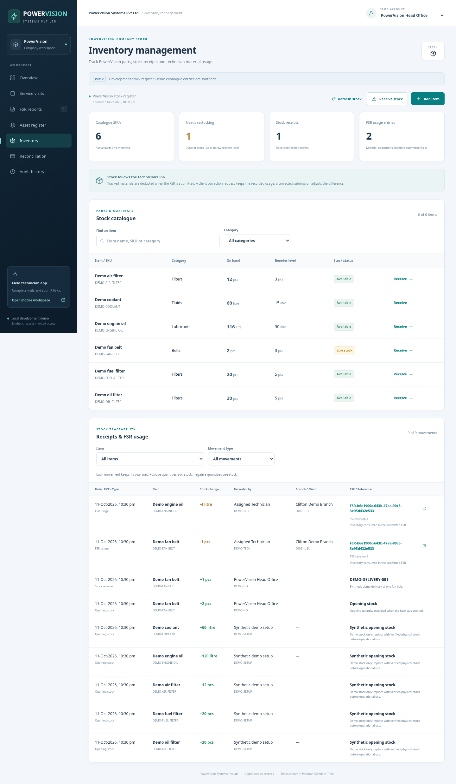
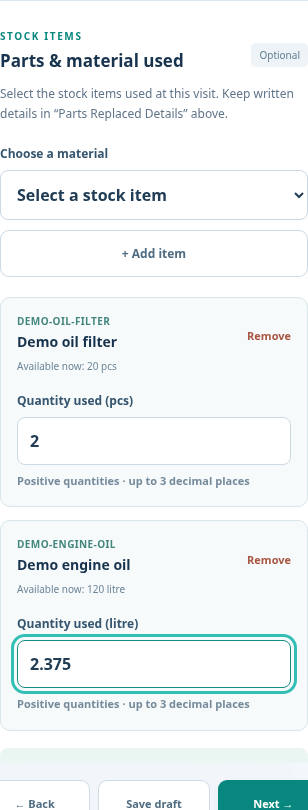

# PowerVision inventory management

PowerVision has a company stock register linked directly to technician FSR submissions. UBL sees the materials used in its authorized FSR reports; the company stock register and receipt history are available to **PowerVision Head Office** and **PowerVision Management**.

## Company stock screen

1. Choose **PowerVision Head Office** or **PowerVision Management**, then **Inventory**.
2. Use **Add item** to enter a unique SKU, name, category, unit, opening quantity and reorder level. Supported units are pieces (`pcs`), litres, metres, kilograms and sets. Quantities support up to three decimal places.
3. Use **Receive stock** against an existing item. Enter the positive received quantity and a receipt reference; a note is optional. This creates a permanent receipt movement and increases the balance.
4. Search/filter the catalogue and review low-stock or out-of-stock indicators. A balance at or below its reorder level is low stock.
5. Review the movement ledger to trace opening balances, receipts, technician consumption and corrected FSR quantities. FSR movements include the technician, client, branch, FSR reference, submission revision and timestamp.

Dashboard summary counts are item/movement counts; quantities in litres and pieces are not added together. The inventory screen is independent of service-month filters. Refresh it to load the latest technician deductions.

## Technician entry

In the technician app, open an assigned visit and complete the existing FSR sections. In **Issue / Job Management**, use **Parts & material used**:

1. Select a stock item and press **Add item**.
2. Enter the quantity used. Repeat for other items, or leave the selection empty when no stock materials were used.
3. Continue using **Next**, or save/exit to resume the same material selection later.
4. Review the materials alongside the readings and photographs, then submit the FSR.

The original **Parts Replaced Details** free-text field and filter-model fields remain part of the FSR. They do not establish item quantities and are not parsed into stock changes. Structured material entry prevents guessing consumption from model numbers or written notes. Historical reports without structured material usage are labelled as not recorded; no stock is retroactively deducted for them.

UBL and PowerVision read the same authoritative material names, SKUs, units and quantities in the detailed report. An earlier report revision retains its original material values even after a correction.

## Stock rules

- Stock is deducted only after a successful FSR submission. Starting a visit and saving a draft do not reserve or deduct anything.
- Availability is checked again by the server inside the submission transaction. If stock is insufficient, the FSR stays editable, its saved draft remains and stock/history do not change. Receive the missing stock or correct the quantity, then retry.
- Branch acknowledgement/rejection does not change stock: the material was already recorded as used.
- A corrected FSR adjusts only the difference from its previous submitted quantities. Using the same quantities again creates no second deduction. A reduction/removal restores the corresponding difference as an FSR correction movement. This is an amendment to recorded usage, not a separate warehouse-return document.
- Omitting `inventoryUsage` in an old client's correction preserves previously booked material. Sending an explicit empty array records a correction to no material usage. The dedicated technician app shows and preserves the earlier selection until it is edited.
- Stock never becomes negative, duplicate item rows are rejected, and no submitted movement is edited or deleted. Wrong receipts have no reversal interface in this increment; use verified inputs and retain their references.

## Demo data and upgrades

On the first inventory-table creation in a database containing the synthetic demonstration gensets, five clearly named `DEMO-*` items receive sample opening balances. They are demonstration stock, not a physical PowerVision stock count. A database containing real assets only receives an empty catalogue. Restarting never replenishes depleted stock or resets any balances.

The migration adds `inventory_items` and `inventory_movements`; existing visits, reports, photographs and drafts remain intact. For a ZIP upgrade, stop the old app, keep the old folder as a backup, and copy its complete `data` folder into a fresh extraction before first start. Do not overwrite two already populated databases. The same local demo-login and deployment limitations still apply.

Warehouse transfers, purchase orders, supplier accounts, barcode scanning, item-price valuation and native offline stock sync are not implemented in this increment.

## Screen previews

All examples above use synthetic stock. Automated tests verify exact fractional balances, persistent stock, authorization, immutable movements, net corrections, complete rollback and competing submissions without overselling. Browser checks verify company item/receipt forms, filters, material draft/resume, insufficient-stock errors, corrected submissions and shared client/company usage display.
