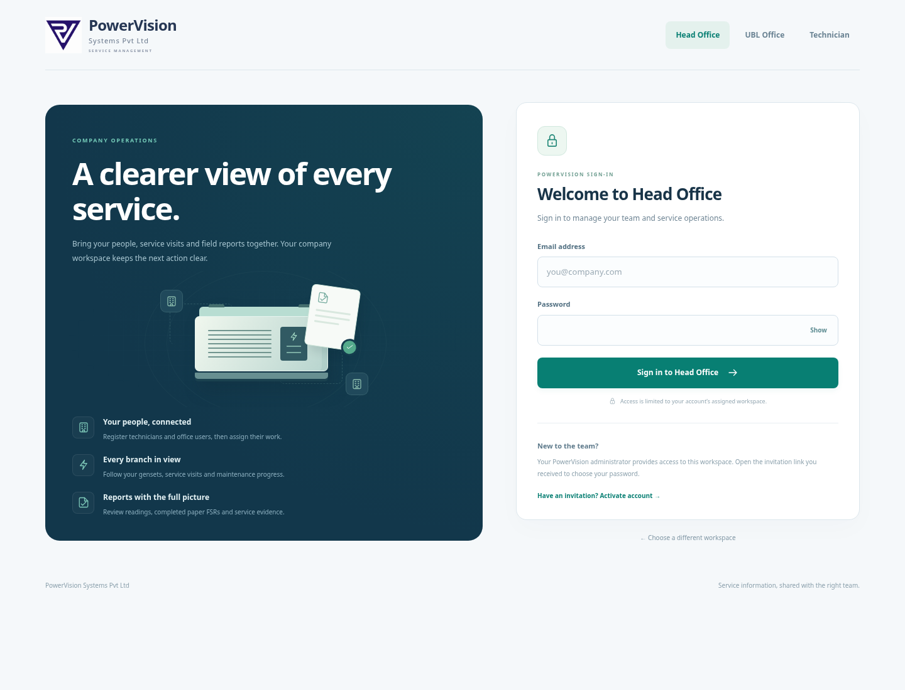
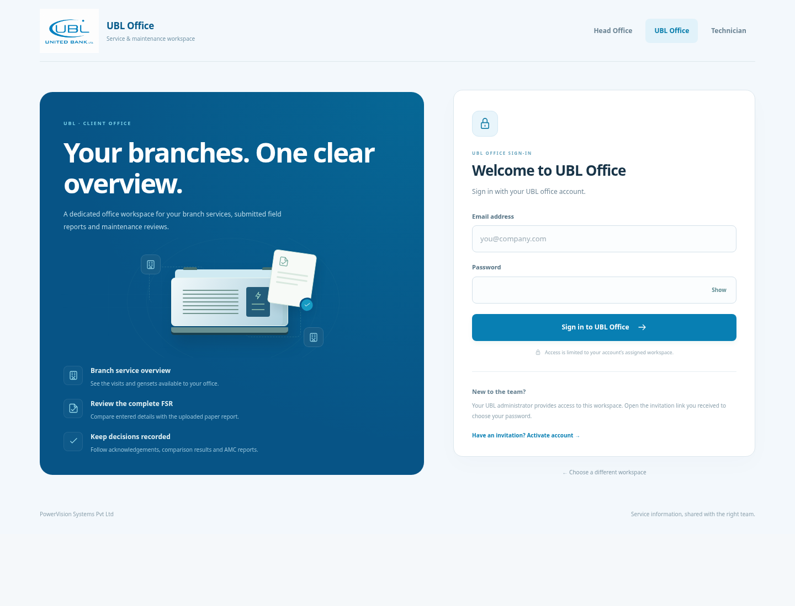
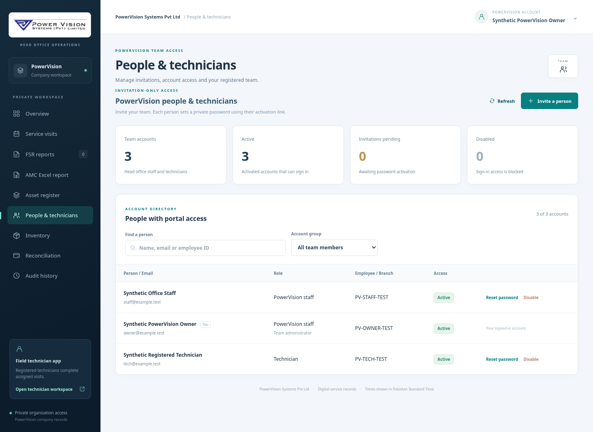
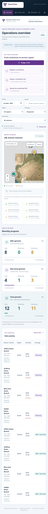

# Registration aur portal access

Ab app mein teen alag sign-in pages hain: **PowerVision Head Office**, **UBL Office**, aur **Technician**. Har account ko uska portal aur permissions administrator deta hai. Public visitor khud ko technician, UBL admin ya PowerVision admin declare karke access nahi le sakta.

## Pehli dafa kya karna hai

1. Project start karein aur terminal mein diya gaya local address apne browser mein kholein.
2. **Set up PowerVision** par click karein. Apna naam, email, employee ID (misal `PV-ADMIN`) aur apna password enter karein. Password 12–128 characters ka hona chahiye.
3. Owner account banne par **PowerVision Head Office** khul jayega. Pehla account banne ke baad setup dobara account nahi banata.

Kisi ready-made email/password ki zaroorat nahi. Owner account aap khud banayenge; upgrade aapke saved service records ko reset nahi karta.

## Technician register karna

1. PowerVision mein **People & Technicians** kholein aur **Invite a person** select karein.
2. Technician ka naam, email aur employee ID enter karein. Account type **Technician** rakhein.
3. Registration ke baad activation link show hoga. **Copy activation link** karein aur technician ko khud provide karein. App filhaal email ya SMS automatically send nahi karta.
4. Technician woh link khol kar apna password set karega. Phir **Technician** sign-in page se login karega.
5. PowerVision ke visit register mein us active technician ko unstarted visit assign karein. Assignment se pehle technician ko doosron ke visits nahi milenge.

Invitation 48 ghantay tak valid hai aur sirf ek dafa use hota hai. Link expire ho jaye to responsible admin **Reinvite** kar sakta hai. Invitation link account activate karne ke liye hai; login ke liye email aur password use hota hai.

## PowerVision staff aur UBL staff

PowerVision admin apne office colleagues register kar sakta hai. Sirf zaroori logon ko administrator permission dein; baqi office staff ko normal account diya ja sakta hai.

PowerVision admin **pehla UBL administrator** invite karega. Us invitation ke activate hone ke baad UBL administrator **UBL Team** se apne office users aur branch reviewers register karega. Branch reviewer ka branch code specify karna hota hai. PowerVision ke paas active UBL accounts ko reset/disable karne ka control nahi hota. Pehle UBL admin ki invitation activate hone se pehle expire ho to original inviter usko reissue kar sakta hai.

| Account | Kya access hoga |
| --- | --- |
| PowerVision office | Apni company ke service records, inventory aur reconciliation |
| PowerVision administrator | Upar wala access, staff/technician registration aur visit assignment |
| UBL head office | UBL reports, assets, progress, manual FSR verification aur AMC Excel |
| UBL administrator | UBL head-office access aur apni UBL team ki registration |
| UBL branch reviewer | Sirf assigned UBL branch ke records aur branch acknowledgment |
| Technician | Sirf assigned visits, FSR form, drafts, photos aur service materials |

**UBL ko Inventory screen, company stock balances, receipts aur stock ledger nahi milta.** Uske apne FSR mein kaun se parts use huay aur kitni quantity thi, woh shared service report mein milti rahegi.

## Account band ya password change karna

Responsible admin account ko **Disable**, **Enable**, ya **Reset password** kar sakta hai. Disable ya reset hote hi us account ke existing sessions revoke ho jate hain. Reset ke baad naya one-time link password set karne ke liye diya jata hai. Apne account ka password account menu ke **Change password** se change karein; uske baad dobara sign in hota hai. Admin khud ko disable/reset nahi kar sakta, aur system last active admin ka access nahi hataata.

Password bhoolne par apne portal administrator se reset link lein. Automated email recovery, bank SSO aur MFA abhi configured nahi hain.

## Update aur local use

Fresh ZIP extract karne ke baad purana `data` folder aur optional `.env` first start se pehle copy karein. Purane reports, inventory aur photos retain hote hain. Yeh local installation hai: dusre mobile/computer ko access dene ke liye shared HTTPS hosting ki alag setup chahiye.

Aapke diye huay PowerVision purple mark aur UBL swoosh logo references ke web assets landing pages aur portals mein use ho rahe hain. Logos apni asal shape mein dikhte hain; PowerVision ke mark ke saath company name alag diya gaya hai.

## Screens

PowerVision ka mobile overview: technician register karein, visit assign karein aur submitted FSR review karein.

