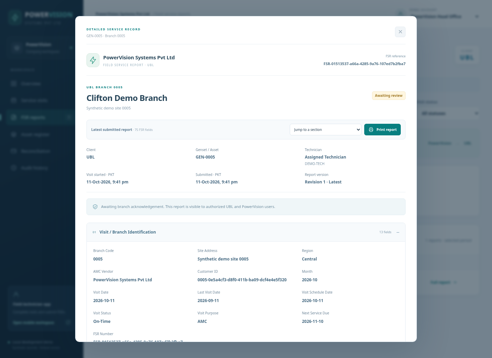

# Detailed FSR reports for UBL and PowerVision

The technician submits one Field Service Report to the shared database. **UBL Head Office** and **PowerVision Head Office** read that same report through their own dashboard workspaces. There is no separate manually copied client report. **PowerVision Management** can read its company visits; UBL branch reviewers see their own client and branch.

## Use the reports screen

1. Open the technician app and submit an assigned FSR, including the three required photographs.
2. In the dashboard, choose **PowerVision Head Office**, then open **Reports** and select the submitted report.
3. Choose **UBL Head Office** and open **Reports** again. The authorized UBL report shows the same submitted readings and evidence.
4. For a branch decision, choose the matching UBL branch reviewer and acknowledge or request corrections. Both offices see that decision; UBL head office itself is read-only.
5. Select a revision to inspect a previous submitted snapshot. Use **Print report** for the browser's print dialog; a supported browser can save the print as PDF.

Reports include the entire 75-entry FSR dictionary: server-computed identifiers and scheduling, service purpose, generator/engine details, running hours, maintenance checks, electrical phase readings, battery/charger checks, filter and oil details, cooling system, issues, actions and the stamped-FSR/before/after photographs. Conditional fields that do not apply remain visibly empty or labelled accordingly rather than being invented.

The **Tracked parts & materials** section also shows the submitted inventory items, SKUs, quantities and units. Both offices see the same usage, including when an older revision is selected. Company stock balances and receipts remain in the company-only [Inventory screen](inventory-management.md).

The report also shows the asset and branch, client/company, assigned technician and employee ID, recorded first visit-start time, submission time, current branch decision/reason/reviewer, and immutable submitted revisions. Old reports without an explicit visit-start event show that the time was not recorded. Their duration is not guessed. Corrected reports retain the original FSR reference and produce a new stored revision.

## Access and counting

UBL sees records belonging to UBL. Other clients and records without a known client are excluded. Access is checked by the API for lists, details, photographs within reports and revisions; hiding a navigation item is not the access boundary.

Submitting an FSR increases the performed count for its assigned monthly visit. Starting or saving a draft does not. A requested correction keeps that visit performed and separately shows that it needs correction. An acknowledgement updates the report and payment eligibility without double-counting the visit.

This remains a synthetic local demo with selectable demo identities. Production user provisioning, authentication, secure hosting and actual UBL assignments are separate delivery steps. Printing uses the browser, not a signed PDF service or an email notification.

## Report preview

Backend regressions verify all 75 field values and all three photos are identical in the two authorized office reports, client isolation and immutable revision history. Browser checks exercise draft save/resume, all ten editable FSR groups, upload/submission, both office views and client acknowledgement returned to the technician. Desktop and 390px mobile layouts completed without JavaScript errors or horizontal page overflow. Live satellite imagery remains subject to the network limitation documented in the map guide.
