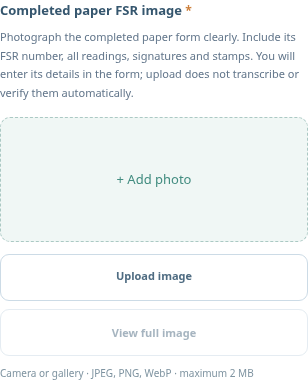

# Technician application

The separate PowerVision technician web app uses registered accounts. PowerVision creates each technician under **People & Technicians**, provides a one-time activation link and assigns service visits after activation. The technician sets their password and signs in through the Technician landing page. There is no selectable demo identity or public role registration.

## Complete a visit

1. Sign in with the activated technician account and select **Fill an FSR** on Home. Choose your assigned visit and select **Fill FSR**. If there are no assigned visits, ask your PowerVision administrator to assign a branch visit to your account; check the selected month too.
2. Confirm the client, branch and genset, then select **Start visit & fill FSR**. For a visit already started, select **Continue FSR**. The first-start timestamp is retained.
3. Fill the fields below the section heading. Use **Form sections** to move between ten core service/evidence sections and thirteen optional paper-form sections. The dictionary has 225 fields, including every field in the supplied FSR V02 paper form.
4. Select **Upload completed FSR** near the top of the form to go straight to **Completed paper FSR image**. Select **Upload image** to choose a camera/gallery image. Once uploaded, the shortcut becomes **View / replace paper FSR**.
5. Save a partial draft, select **Save & exit**, or continue with **Next**. Server drafts survive browser/server restarts and reject stale saves from a second window. Select consumed tracked inventory items and quantities under **Issue / Job Management**; paper spare-part text is a separate transcription and does not issue stock automatically.
6. Include the required before/after photos as well as the completed signed/stamped paper FSR image. JPEG, PNG or WebP images are limited to 2 MB each. Optional signature crops use the same limit.
7. Select **Review & submit**, compare the paper image against your entries, and enlarge/zoom/replace it when necessary. Select **Submit FSR** after completing all required fields and photos. Uploading the paper does not transcribe or automatically verify your entries.
8. Read the company/client manual comparison results and branch acknowledgment in **Reports**. If the matching branch requests a correction, update and resubmit; earlier snapshots and verification results remain available.

The upload shortcut saves the current partial draft **before** changing sections and scrolling to the paper-image upload. If saving fails, the form stays in the current section and displays the error. Required fields and photos are still checked before submission.

The client is UBL and the responsible company is taken from the service assignment. The technician cannot enter the PowerVision or UBL office portals with the technician account, manage office users or read the company stock ledger.

## Persistence and connectivity

Starting/saving a draft does not count as performed or deduct stock. Successful submission counts as performed and commits stock usage atomically. Corrections adjust only the quantity difference; manual review/rejection does not issue or return stock.

API paths remain `/api/technician/...`, with a separate portal-bound HttpOnly session cookie. Signout revokes the session. A missing/expired/disabled session returns the user to the technician sign-in page.

The service worker caches public static assets only. Private HTML, sessions, API responses, FSR values and photos are never cached. Offline FSR synchronization is not implemented; connectivity to the running server is required for visits, drafts and submission. Physical-phone camera/installation has not been validated in the Linux browser checks. This is a mobile web app, not a native APK.

[Account registration](portal-access.md) · [Paper FSR walkthrough](fsr-v02-and-ubl-reports.md)
